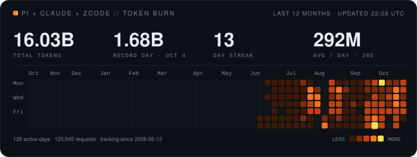

<div align="center">

<h1>hakergeniusz</h1>

<p><b>Proffesional tokenmaxxer™</b></p>

<p>
I don't write code for your repo — I write prompts that do.
</p>

<p>
  
  
  
  
</p>

</div>

<br/>

<h3 align="center"><code>$ pi --tokens</code></h3>

<p align="center">
  
</p>

<p align="center"><sub>Daily token usage from my  <a href="https://github.com/earendil-works/pi">Pi coding agent</a>, rendered from local telemetry.</sub></p>

<br/>

<h3 align="center"><code>$ gh stats</code></h3>

<p align="center">
  
</p>

<p align="center">
  <a href="https://github.com/hakergeniusz/metrics-sync">
    
  </a>
  <a href="https://github.com/hakergeniusz/hakergeniusz">
    
  </a>
  <a href="https://gist.githubusercontent.com/hakergeniusz/b2dff30a5b9f2ae680b34cddb54067c5/raw/uptime.json">
    
  </a>
</p>

<details>
<summary>🖥️ local machine (Arch Linux)</summary>

```text
Started UTC: 2026-05-21 21:15:32
```

Token usage and fastfetch are pushed from this machine by a systemd timer, only when the token count changes.

</details>

<br/>

<p align="center">
  
</p>
